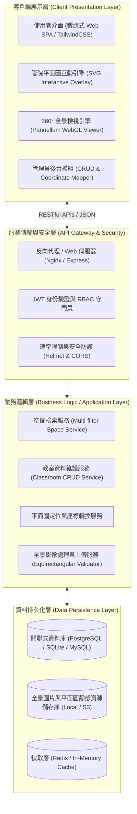
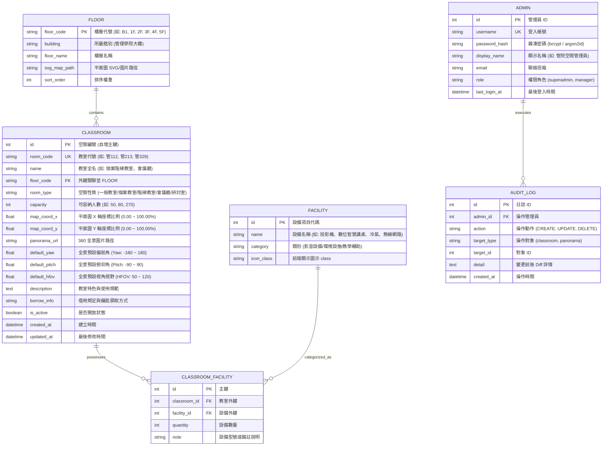
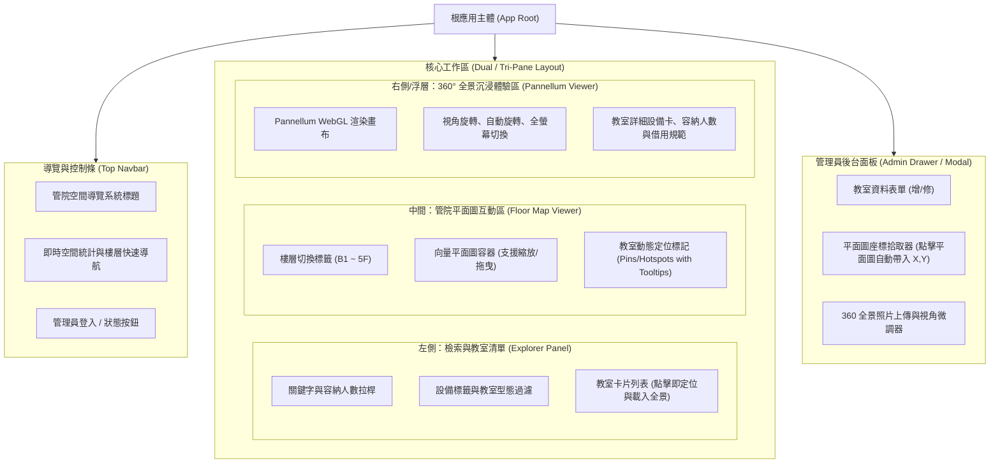

# 國立暨南國際大學 管理學院空間查詢模組 (NCNU College of Management Space Query Module)
## 系統架構與軟體工程規格設計書 (System Architecture & Software Engineering Specification)

---

## 1. 系統概述與需求分析 (System Scope & Requirements)

### 1.1 背景與目標
本模組旨在提供國立暨南國際大學（NCNU）管理學院師生、訪客及行政人員一套直覺、現代化且免登入的空間查詢系統，同時提供管理員便利的後台維護介面，以實現：
1. **免登入空間導覽**：使用者可隨時查閱管院各樓層教室基本資訊、容量、設備與配置。
2. **360° 全景沉浸式瀏覽**：整合開源 WebGL 360 度環景引擎 [Pannellum](https://pannellum.org/)，提供身歷其境的教室實景體驗。
3. **管院互動式平面圖**：以向量 SVG / 高解析平面圖標示各教室地理位置，並實現「點擊平面圖標註 $\leftrightarrow$ 查看教室資訊 $\leftrightarrow$ 展開 360° 全景」之雙向聯動。
4. **管理員安全維護機制**：具備權限隔離之後台，管理員可對教室基本資料、設備配備、平面圖標註座標與全景照片進行增、刪、改、查（CRUD）。

### 1.2 使用者角色與用例分析 (Actor & Use Case Matrix)

| 角色 | 權限需求 | 核心使用場景 (Use Cases) |
| :--- | :--- | :--- |
| **訪客 / 一般師生 (Guest)** | 免登入 (Public Access) | 1. 依樓層（B1～5F）、教室類型、設備、容納人數搜尋與篩選教室。 2. 檢視教室基本資訊（容量、冷氣、投影設備、智慧講桌等）。 3. 瀏覽 360 度全景影像（可自由旋轉、縮放、全螢幕）。 4. 在管理學院平面圖上定位教室位置或透過點選平面圖挑選教室。 |
| **空間管理員 (Administrator)** | 須身份驗證 (JWT Auth) | 1. 管理員安全登入 / 登出。 2. 新增、編輯、刪除教室空間資訊。 3. 設定與調整教室在管院平面圖上的 (X, Y) 標註點座標。 4. 上傳或更新 360 度全景照片 (Equirectangular 影像)。 5. 管理設備標籤與設施清單。 |

---

## 2. 系統整體架構設計 (System Architecture)

本系統採現代化前後端分離架構（Decoupled Client-Server Architecture），並具備離線單機預覽（Mock/SPA Mode）與標準雲端/容器化部署模式：

---

## 3. 資料庫設計 (Database Schema & ERD)

資料庫設計遵循第三正規化（3NF），完整對應國立暨南國際大學管理學院（管 112、管 213、管 268、管 329、管 432 等）之真實空間資訊與欄位需求：

---

## 4. RESTful API 規格設計 (API Specification)

所有對外 API 均遵循 RESTful 原則，資料交換採用 UTF-8 編碼之 JSON 格式。

### 4.1 訪客公開端點 (Public Endpoints - 免登入)

| 方法 | 路徑 | 說明 | 查詢參數 (Query Params) |
| :--- | :--- | :--- | :--- |
| `GET` | `/api/v1/classrooms` | 查詢教室列表 (支援複合篩選) | `floor`: 樓層代碼 (1F, 2F...) `type`: 空間型態 `min_capacity`: 最小容納人數 `facility_ids`: 設備 ID 清單 `keyword`: 關鍵字搜尋 |
| `GET` | `/api/v1/classrooms/:id` | 取得單一教室詳細資訊 (含設備清單、全景配置、平面圖座標) | 無 |
| `GET` | `/api/v1/floors` | 取得所有樓層資訊與各樓層平面圖路徑 | 無 |
| `GET` | `/api/v1/floors/:floorCode/map` | 取得指定樓層之平面圖圖資與該樓層所有教室之位置座標清單 | 無 |
| `GET` | `/api/v1/facilities` | 取得所有標準設備項目清單 (供前端篩選器展示) | 無 |

### 4.2 管理員專用端點 (Admin Endpoints - 需 Bearer JWT Token)

| 方法 | 路徑 | 說明 | 請求主體 (Request Body) |
| :--- | :--- | :--- | :--- |
| `POST` | `/api/v1/auth/login` | 管理員登入驗證，簽發 JWT Token | `{ "username": "admin", "password": "..." }` |
| `GET` | `/api/v1/auth/me` | 驗證當前管理員身份與權限 | Header: `Authorization: Bearer <token>` |
| `POST` | `/api/v1/classrooms` | 新增教室空間資料 | 包含教室名稱、代號、樓層、容量、座標、全景圖等 JSON |
| `PUT` | `/api/v1/classrooms/:id` | 修改指定教室資料與座標標註 | 欲更新之教室欄位與設備清單 |
| `DELETE` | `/api/v1/classrooms/:id` | 刪除教室資料 | 無 |
| `POST` | `/api/v1/upload/panorama` | 上傳 360 度全景照片 | `multipart/form-data` (檔案格式: JPG/PNG, 2:1 長寬比) |
| `POST` | `/api/v1/upload/floorplan` | 上傳更新樓層平面圖圖資 | `multipart/form-data` (SVG 或 高解析 PNG) |

---

## 5. 前端視圖與互動核心模組設計 (Frontend Architecture)

前端系統模組包含三大互動核心：

### 5.1 Pannellum 360 全景檢視引擎整合規格
- **引擎**：採用標準開源 [Pannellum 2.5.6](https://pannellum.org/)（WebGL 加速，支援行動端觸控陀螺儀）。
- **投影類型**：`equirectangular`（等距長方投影，寬高比 2:1）。
- **參數配置**：
  - `autoLoad: true`（自動載入紋理）
  - `autoRotate: -2`（預設慢速環繞漫遊，提升空間感）
  - `compass: true`（提供方位羅盤指針）
  - `showZoomCtrl: true, showFullscreenCtrl: true`
  - `hotSpots`：支援在全景中自訂跳轉熱點（如從講台望向後方、或穿梭至相鄰教室/走廊）。

### 5.2 管院平面圖座標系統 (Interactive Floor Plan)
- **座標標準化**：採用百分比相對座標體系（$0.0\% \le X \le 100.0\%$, $0.0\% \le Y \le 100.0\%$），徹底解決各裝置螢幕解析度或響應式縮放時座標位移的問題。
- **雙向聯動機制**：
  1. 使用者在列表點選教室 $\rightarrow$ 平面圖自動平移至該教室 Pin 標記並高亮脈衝動效 $\rightarrow$ 右側同步載入 360° 全景。
  2. 使用者在平面圖上點擊某教室 Marker $\rightarrow$ 展開資訊 Tooltip $\rightarrow$ 自動過濾選中該教室。
  3. 管理員在後台點擊「在地圖上選取座標」模式 $\rightarrow$ 直接在平面圖點擊任意位置即可自動捕獲百分比座標並回填表單。

---

## 6. 國立暨南國際大學管院預載教室資料集 (Seed Dataset)

依據暨大國企系與管理學院實際公開空間，預先建立之教室資料範例：

| 教室代號 | 教室名稱 | 樓層 | 類型 | 容納人數 | 主要設備 |
| :--- | :--- | :---: | :--- | :---: | :--- |
| **管112** | 一般教學教室 | 1F | 一般教室 | 50人 | 投影機、投影螢幕、無線網路、白板、冷氣與電扇、有線麥克風 |
| **管113** | 一般教學教室 | 1F | 一般教室 | 50人 | 雙投影布幕、冷氣、無線網路、白板、多媒體講桌 |
| **管115** | 一般教學教室 | 1F | 一般教室 | 50人 | 投影設備、擴音系統、冷氣、白板 |
| **管206** | 專業討論教室 | 2F | 研討室 | 40人 | 投影機、白板、冷氣、移動式活動桌椅 |
| **管213** | 個案研究教室 | 2F | 個案教室 | 50人 | 環形個案討論桌、多螢幕投影、無線麥克風、錄播系統 |
| **管226** | 個案階梯教室 | 2F | 階梯教室 | 80人 | 階梯馬蹄形座椅、高流明投影機、冷氣、專業音響 |
| **管260** | 國際學術會議廳 | 2F | 會議廳 | 120人 | 劇院型座椅、同步口譯座、雙投影、舞台燈光 |
| **管268** | 大型學術演講廳 | 2F | 會議廳 | 270人 | 大型劇院座椅、雙大螢幕投影、專業音響、中央空調 |
| **管329** | 智慧教學教室 | 3F | 一般教室 | 60人 | 智慧多功能講桌、觸控黑板、冷氣、無線投影 |
| **管331** | 中型綜合教室 | 3F | 一般教室 | 100人 | 高清投影設備、無線網路、麥克風、活動折合課桌椅 |
| **管371** | 管理學院演講廳 | 3F | 會議廳 | 250人 | 階梯禮堂座椅、LED大型螢幕、廣播系統、舞台區 |
| **管432** | 國企系系會議室 | 4F | 會議室 | 20人 | 橢圓大型會議桌、視訊會議鏡頭、投影電視、白板 |
| **管443** | 專業研討教室 | 4F | 一般教室 | 50人 | 投影機、冷氣、白板、分組討論長桌 |
| **管451** | 碩博士生研討室 | 4F | 研討室 | 20人 | 互動螢幕、沙發討論區、白板、高速網路 |
| **管457** | 專業多功能教室 | 4F | 一般教室 | 60人 | 投影機、移動式白板、冷氣、麥克風系統 |

---

## 7. 安全性與軟體工程非功能性需求 (Non-Functional Requirements)

1. **訪客隱私與安全性**：
   - 訪客查詢端點為完全無狀態（Stateless）唯讀存取，不收集個人隱私資訊。
   - 所有寫入與刪除路由均經由 JWT Middleware 阻絕，避免非法竄改。
2. **密碼安全性**：
   - 管理員密碼採用安全雜湊（如 BCrypt，Salt Rounds $\ge 10$），防止明文洩漏。
3. **媒體資源優化**：
   - 360 全景影像提供縮圖（Thumbnail）與多解析度漸進式載入，避免因高畫質全景圖（8K equirectangular）造成頻寬過載。
4. **高擴展性**：
   - 系統模組化解耦，可輕鬆接入暨大單一簽入系統（NCNU Portal SSO / OAuth2），或與學校教務處空間借用系統進行 API 串接。
